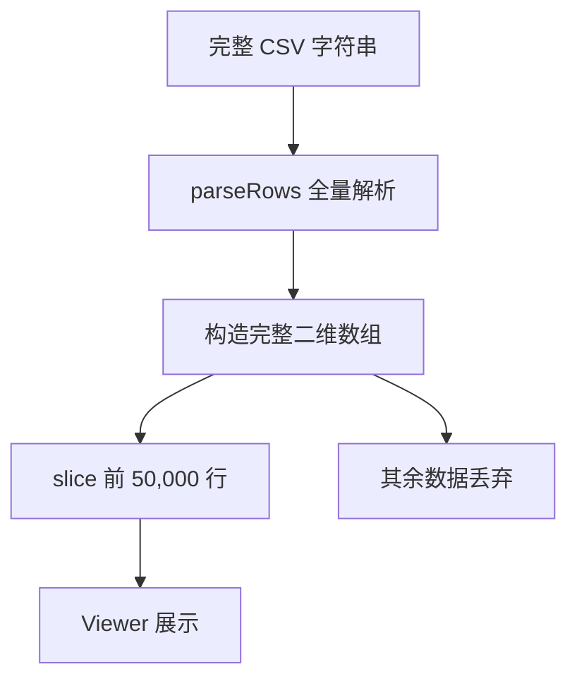

# Peekview Viewer 核心问题核实报告

> **审查对象**：`randomgitsrc/peekview`
>
> **审查基准**：`1e0a57b94a85e94e5cf763b952508ff3f5eb186f`
>
> **审查范围**：Viewer、多文件成果入口、Markdown 目录、CSV/TSV 解析、HTML 渲染与资源注入
>
> **审查方式**：GitHub 静态源码审阅，并对照仓库已有测试代码
>
> **验证限制**：本次没有 clone 仓库、没有运行测试、没有浏览器实测、没有生产环境验证。因此，本文可以确认代码逻辑和潜在问题，但不声称已经复现运行时故障。

---

## 一、核实结论

| 编号 | 问题 | 核实结果 | 重要程度 |
|---|---|---|---|
| V-01 | 多文件 Entry 默认打开的文件缺乏明确入口语义 | 已确认 | 高 |
| V-02 | Markdown 目录与正文标题 ID 不一致 | 已确认 | 高 |
| V-03 | CSV 截断限制没有限制实际解析成本 | 已确认 | 高 |
| V-04 | CSV 截断后排序、过滤控件失去实际作用 | 已确认 | 中 |
| V-05 | HTML Viewer 允许外部网络请求，存在内容外传风险 | 已确认配置，风险需结合使用场景评估 | 高 |
| V-06 | HTML sibling 资源注入缺少总大小限制 | 已确认 | 高 |
| V-07 | HTML 资源注入最多处理 50 个文件 | 已确认 | 中 |
| V-08 | HTML 大文件阈值使用字符数而非真实字节数 | 已确认 | 中 |

**整体判断：这些问题值得进入 Peekview 的真实改进清单。**

它们不是要求 Peekview 增加新的产品方向，而是改善已有核心能力的正确性、可靠性、安全性和性能边界。

---

## 二、V-01：多文件成果缺少明确的默认入口

**状态：已确认**

### 1. 代码事实

前端 `entryDetail.ts` 的 `loadEntry()`：

```ts
const targetFile = fileId != null
  ? entry.files.find(f => f.id === fileId) ?? entry.files[0]
  : entry.files[0]
```

没有指定 `fileId` 时，直接使用：

```ts
entry.files[0]
```

后端 `EntryService.get_entry()` 获取文件的方式是：

```python
files = session.exec(
    select(File).where(File.entry_id == entry.id)
).all()
```

这里没有 `order_by()`。

因此：

1. 前端默认选择 API 返回的第一个文件。
2. 后端没有明确规定文件返回顺序。
3. 数据库查询没有明确排序契约。
4. 默认文件并不一定是用户最希望看到的成果文件。

与此同时，`FileTree.vue` 使用另一套规则：

- 目录优先；
- 目录和文件分别按名称排序。

这意味着默认激活文件与文件树的视觉排序没有统一的入口语义。

### 2. 实际影响

例如 Agent 发布：

```text
research/
├── assets/
│   ├── architecture.svg
│   └── comparison.png
├── data/
│   └── results.csv
├── README.md
├── analysis.md
└── index.html
```

用户打开 Entry 时，可能首先看到图片、数据文件或其他源码文件，而不是成果说明或最终报告。

这不是说 README 一定应该成为入口，而是当前系统没有表达“这个文件是主要成果”的机制。

### 3. 建议

暂时不要增加 `main_file` 数据库字段。

建议先做轻量策略：

1. 检查是否存在明确的成果入口文件。
2. 如果存在，按约定优先展示。
3. 没有明确入口时，保持兼容行为。
4. 文件树继续展示完整文件集合。

入口优先级需要通过真实 Agent 发布样本验证，不能假设所有项目都使用 README。

还需要考虑 HTML Demo：如果 Entry 的主要成果是 `index.html`，那么优先展示 README 反而可能不是最佳体验。

### 4. 参考源码

- `frontend-v3/src/stores/entryDetail.ts`
- `frontend-v3/src/components/FileTree.vue`
- `backend/peekview/services/entry_service.py`

---

## 三、V-02：Markdown 目录与正文标题 ID 不一致

**状态：已确认**

这是本轮最明确的 Markdown 正确性问题之一。

### 1. 两套独立逻辑

正文标题由 `useMarkdown.ts` 处理。

核心逻辑：

```ts
const id = slugify(text)
token.attrSet('id', id)
headings.push({ level, text, id })
```

目录则由 `useEntryDetailComputed.ts` 的 `extractHeadings()` 处理：

```ts
for (const line of content.split('\n')) {
  const match = line.match(/^(#{1,6})\s+(.+)$/)
  // ...
}
```

两套逻辑虽然使用相近的 slug 规则，但目录额外实现了重复 ID 去重，正文没有。

### 2. 问题 A：重复标题

输入：

```markdown
## 设计方案

第一部分。

## 设计方案

第二部分。
```

正文渲染时，两处标题都会获得：

```html
<h2 id="设计方案">设计方案</h2>
<h2 id="设计方案">设计方案</h2>
```

而目录生成的是：

```text
设计方案
设计方案-1
```

第二个目录项跳转时会寻找：

```js
document.getElementById('设计方案-1')
```

但正文中并没有这个 ID。

因此第二个目录项可能无法定位到正确标题。

### 3. 问题 B：代码块中的标题被目录误识别

输入：

````markdown
## 正常章节

正文内容。

```markdown
## 这其实是代码示例
```
````

Markdown 渲染器知道代码围栏中的内容不是标题。

但目录提取器只是逐行扫描原始文本，没有维护代码围栏状态。

因此：

`## 这其实是代码示例`

可能被错误地加入目录。

### 4. 问题 C：Setext 标题无法被当前目录提取逻辑识别

例如：

```markdown
章节标题
---------
```

Markdown 解析器支持这种标题语法。

但目录正则只匹配以 `#` 开头的 ATX 标题，因此不会提取该标题。

### 5. 建议

不要继续维护两套 Markdown 标题解析规则。

更合理的实现：

```text
Markdown 原文
     │
     ▼
Markdown Parser
     │
     ▼
AST / Tokens
     │
     ├── 正文 HTML
     │
     └── TOC Headings
```

标题 ID 应当在同一个解析阶段生成，并同时用于正文和目录。

这样可以统一处理：

- 重复标题；
- 代码块；
- Setext 标题；
- 标题中的强调、链接等内联语法；
- CJK 标题；
- 锚点跳转。

### 6. 测试建议

新增以下测试：

| 测试 | 预期 |
|---|---|
| 重复的两个同名标题 | ID 唯一，目录全部正确 |
| 标题出现在代码围栏中 | 不加入目录 |
| Setext 标题 | 正确加入目录 |
| 标题包含粗体、链接 | 目录与正文 ID 一致 |
| 中文重复标题 | 正确去重 |
| 不同级别标题 | 目录层级正确 |

当前已有 Markdown 扩展测试覆盖数学公式、脚注、任务列表、上下标等，但本次检查没有找到针对上述目录一致性问题的对应测试。

### 7. 参考源码

- `frontend-v3/src/composables/useMarkdown.ts`
- `frontend-v3/src/composables/useEntryDetailComputed.ts`
- `frontend-v3/src/components/TocNav.vue`

---

## 四、V-03：CSV 截断没有限制实际解析成本

**状态：已确认**

### 1. 代码事实

`useCsvParser.ts`：

```ts
export function parseCsv(
  content: string,
  delimiter: ',' | '\t',
  maxRows: number = DEFAULT_MAX_ROWS
): CsvParseResult {
  const cleaned = content.replace(/^\uFEFF/, '')
  const allRows = parseRows(cleaned, delimiter)
  const headers = allRows.length > 0 ? allRows[0] : []
  const dataRows = allRows.slice(1)
  const totalRows = headers.length > 0 ? dataRows.length + 1 : 0
  const truncated = totalRows > maxRows
  const rows = dataRows.slice(0, maxRows)

  return { headers, rows, totalRows, truncated }
}
```

核心问题在于：

```ts
const allRows = parseRows(cleaned, delimiter)
```

发生在截断之前。

也就是说，系统先完整解析所有行，再截取前 50,000 行。

### 2. 实际资源消耗



50,000 行限制只限制了最终保留的数据行数，并没有限制：

- 解析时间；
- 全量二维数组的内存占用；
- 单元格字符串的累计内存；
- 主线程同步执行时间。

而 `TableView.vue` 通过同步 watcher 调用 `parseCsv()`：

```ts
watch(
  () => props.content,
  () => {
    parsed.value = parseCsv(
      props.content,
      props.delimiter,
      props.maxRows
    )
  },
  { immediate: true },
)
```

因此，大文件解析会在主线程同步执行。

### 3. 实际影响

一个包含大量行的 CSV，即使最终只展示 50,000 行，也可能因为完整解析而导致：

- 页面卡顿；
- 浏览器内存增长；
- 页面交互延迟；
- 极端情况下页面崩溃。

这是可以从实现逻辑直接推导出来的性能风险，但实际卡顿程度需要浏览器实测。

### 4. 建议

建议分阶段优化。

**第一阶段：限制解析成本**

- 解析时达到最大展示行数后停止构造完整数据数组。
- 继续扫描剩余输入，或者使用可提前终止的流式解析策略，获取必要的截断信息。
- 为文件大小设置合理保护。
- 避免在主线程一次性执行超大数据解析。

**第二阶段：按需提升能力**

如果实际使用中出现更大规模数据的需求，再考虑：

- Web Worker；
- 增量解析；
- 虚拟滚动；
- 按需加载。

不要因为 CSV Viewer 存在，就把 Peekview 变成完整的数据分析平台。

### 5. 参考源码

- `frontend-v3/src/composables/useCsvParser.ts`
- `frontend-v3/src/components/TableView.vue`

---

## 五、V-04：CSV 截断状态下，排序和过滤控件失去实际作用

**状态：已确认**

这与 V-03 是两个独立问题。

### 1. 代码事实

`TableView.vue`：

```ts
const pagedData = computed<CsvRow[]>(() => {
  if (parsed.value.truncated) return []
  // ...
})
```

正常情况下，表格使用 TanStack Table 的排序、过滤模型：

```ts
getSortedRowModel: getSortedRowModel(),
getFilteredRowModel: getFilteredRowModel(),
```

但当数据被截断时，模板改为：

```vue
<template v-if="parsed.truncated">
  <tr v-for="(row, rowIndex) in parsed.rows">
    <td v-for="(cell, cellIndex) in row">
      {{ cell }}
    </td>
  </tr>
</template>
```

也就是说，截断状态下直接渲染原始 `parsed.rows`。

与此同时，表头仍然显示：

- 排序按钮；
- 过滤输入框。

但这些控件操作的是 TanStack Table，而截断状态下的正文并没有使用其计算结果。

### 2. 用户看到的现象

用户可能：

1. 点击列标题，尝试排序；
2. 在过滤框输入条件；
3. 发现数据没有发生变化。

这是一个明确的交互语义问题：界面呈现了功能，但实际数据没有应用这些功能。

### 3. 建议

两个方案：

- 截断状态下隐藏排序和过滤控件，明确告知当前只展示前 N 行。
- 或者让排序、过滤真正作用于当前保留的数据集合。

我倾向于第一阶段先采用第一种，避免给用户错误预期。

如果将来引入服务端查询或流式数据访问，再考虑更完整的排序和过滤。

### 4. 参考源码

- `frontend-v3/src/components/TableView.vue`

---

## 六、V-05：HTML Viewer 的外部网络访问边界

**状态：CSP 配置已确认，数据外传风险需要结合实际浏览器验证**

这一项需要特别谨慎，不能简单写成“存在 XSS 漏洞”。

### 1. 当前安全措施

`HtmlViewer.vue` 使用：

```html
<iframe
  sandbox="allow-scripts allow-forms"
  referrerpolicy="no-referrer"
/>
```

没有 `allow-same-origin`。

这是有价值的隔离措施：

- iframe 使用独立的 opaque origin；
- HTML 内容不能直接访问宿主页面的 DOM；
- 不能直接读取宿主页面的 Cookie 或 localStorage；
- 没有授予弹窗和顶层导航权限。

后端还通过 HTTP 响应头设置 CSP。

### 2. 目前 CSP 的实际权限

`backend/peekview/api/files.py`：

```python
RENDER_CSP = (
    "default-src 'unsafe-inline' 'unsafe-eval' blob: data: https:; "
    "script-src 'unsafe-inline' 'unsafe-eval' blob: data: https:; "
    "style-src 'unsafe-inline' blob: data: https:; "
    "img-src blob: data: https:; "
    "media-src blob: data: https:; "
    "font-src blob: data: https:; "
    "connect-src blob: data: https:; "
    "worker-src blob:; "
    "frame-src 'none'; "
    "frame-ancestors 'self'; "
    "form-action 'none';"
)
```

其中值得关注的是：

```text
script-src ... https:
connect-src ... https:
```

这允许 HTML 页面：

- 加载外部 HTTPS 脚本；
- 使用 HTTPS 网络连接；
- 通过脚本请求外部服务。

### 3. 真实风险是什么？

假设一个私有 Entry 包含敏感研究资料，同时其中有一个 HTML 文件。

用户打开这个 HTML 文件时，脚本能够读取当前 iframe 自己的文档内容。

由于 `connect-src` 允许 HTTPS，脚本可能将自己读取到的内容发送到外部服务。

例如，恶意 HTML 可以尝试将页面内容编码后，通过外部请求发送出去。

需要明确：

- iframe 的 sandbox 仍然阻止其直接读取宿主 DOM 和 Cookie。
- 这不是已经证明宿主站点发生 XSS。
- CSP 的 `form-action 'none'` 会限制表单提交。
- 但 `connect-src https:` 仍然给脚本留下了外部网络通信通道。

因此，风险是：

**用户打开不可信 HTML 时，HTML 自身拥有的内容可能被脚本外传。**

这对私有成果尤其值得关注。

### 4. 产品层面的建议

我建议区分两种 HTML 使用模式：

| 模式 | 目标 | 默认权限 |
|---|---|---|
| 安全预览 | 展示 HTML 内容，优先保护用户 | 限制外部脚本与网络连接 |
| 交互式 Demo | 允许用户体验完整网页交互 | 明确提示并允许相应权限 |

但不建议立即把现有 HTML Viewer 全部改成禁止 JavaScript。

因为 HTML Demo 是 Peekview 的重要成果类型，完全禁止脚本可能直接破坏核心使用场景。

应该先定义安全边界，再选择兼容方案。

### 5. 参考源码

- `frontend-v3/src/components/HtmlViewer.vue`
- `backend/peekview/api/files.py`
- `backend/tests/test_html_render.py`

---

## 七、V-06：HTML sibling 资源注入缺少总大小限制

**状态：已确认**

这是本轮另一个值得优先处理的问题。

### 1. 当前实现

HTML Viewer 会将同一个 Entry 中其他文件的 ID 传给后端：

```ts
const siblingFileIds = computed(() => {
  if (!currentEntry.value || !activeFile.value) return []
  if (activeFile.value.language !== 'html') return []

  return currentEntry.value.files
    .filter(f => f.id !== activeFile.value!.id)
    .map(f => f.id)
})
```

后端接收这些 ID：

```python
inject_ids = parse_inject_ids(inject, file_id)
```

然后读取对应文件并注入 HTML。

当前有两个限制：

```python
_MAX_INJECT_IDS = 50
_BINARY_SIZE_LIMIT = 768 * 1024
```

但它们不是完整的资源预算。

### 2. 二进制文件限制

二进制文件单个超过 768KB 时会跳过：

```python
if file_record.is_binary and file_record.size > _BINARY_SIZE_LIMIT:
    return None
```

注意这是单文件限制，不是总量限制。

例如，50 个文件，每个文件都没有超过 768KB，仍然可能产生很大的总响应。

而 Base64 编码还会进一步增加数据体积。

### 3. 文本文件没有同等级限制

对于文本文件：

```python
raw = storage.read_file(...)
```

之后直接：

```python
content=raw.decode("utf-8", errors="replace")
```

没有看到对应的：

- 单文件文本大小限制；
- 全部 sibling 文本总大小限制；
- 最终 HTML 响应大小限制。

因此，一个很小的 HTML 文件可以引用或注入大量文本资源，最终生成的 HTML 远大于原始 HTML。

### 4. 50 个文件上限

`parse_inject_ids()` 最多保留 50 个 ID。

超过 50 个时，后面的 ID 被截断。

这意味着一个包含大量文件的 HTML Demo，可能出现资源无法注入的情况。

当前前端又会传递所有 sibling IDs，因此这个上限并不是用户主动选择的结果，而是后端静默截断。

### 5. 建议

应该建立统一的资源注入预算：

```text
HTML 主文件
   +
CSS / JS
   +
图片 / 字体 / SVG
   │
   ▼
总大小预算检查
   │
   ├── 满足预算：正常注入
   │
   └── 超出预算：明确反馈
```

建议至少增加：

1. 单个文本资源大小限制；
2. 全部 sibling 文件的总大小限制；
3. 注入后 HTML 的总大小限制；
4. 资源数量限制；
5. 超限时明确提示，而不是静默丢弃资源。

具体数值应该通过实际 HTML Demo 样本和浏览器性能测试确定，不应直接拍脑袋设定。

### 6. 参考源码

- `frontend-v3/src/composables/useEntryDetailComputed.ts`
- `frontend-v3/src/components/HtmlViewer.vue`
- `backend/peekview/api/files.py`
- `backend/peekview/services/html_render_service.py`

---

## 八、V-07：HTML 资源注入的文件数量限制

**状态：已确认**

当前：

```python
_MAX_INJECT_IDS = 50
```

`parse_inject_ids()` 会去重，并排除主 HTML 文件，然后最多保留 50 个 ID。

这个设计本身有保护意义。

但目前有一个产品体验问题：

- 前端会把所有 sibling 文件 ID 传给后端。
- 后端只取前 50 个。
- 超出部分没有明确告知用户。

对于简单 HTML Demo，通常问题不大。

对于复杂的多文件 Demo、组件库、较大的静态网站，则可能出现资源不完整。

建议：

- 保留数量上限；
- 增加注入结果统计；
- 超限时向用户明确提示；
- 不要让页面看起来像完整渲染成功，实际却遗漏了部分资源。

---

## 九、V-08：HTML 大文件判断使用字符串长度，而不是真实文件大小

**状态：已确认**

`HtmlViewer.vue`：

```ts
const contentSize = computed(() => {
  if (testContentSize !== null && testContentSize !== undefined) {
    return testContentSize
  }
  return props.content.length
})
```

阈值：

```ts
const SIZE_WARN = 512 * 1024
const SIZE_BLOCK = 2 * 1024 * 1024
```

也就是说，判断使用的是 JavaScript 字符串长度。

它不等于 UTF-8 文件字节数。

对于英文内容，两者通常接近；对于中文等非 ASCII 内容，真实字节数可能明显更大。

此外，HTML 文件内容在触发手动渲染之前已经通过 API 读取到了前端。

所以当前策略主要是限制 iframe 自动渲染，而不是限制文件传输或前端内存占用。

### 建议

1. 使用后端提供的文件 `size` 作为主要判断依据。
2. 保留前端字符串长度作为必要的辅助保护。
3. 明确区分文件加载限制与 HTML 执行/渲染限制。

还有一个小细节：当前判断使用 `>= 2MB`，因此恰好 2MB 就进入手动渲染模式，不是严格大于 2MB。

---

## 十、已有测试覆盖情况

本次检查了仓库中相关测试源码，但没有执行测试。

| 问题 | 仓库已有测试 | 目前测试的不足 |
|---|---|---|
| 多文件默认入口 | 有 FileTree 排序测试 | 没有默认主文件语义测试 |
| Markdown 目录一致性 | 有 Markdown 扩展测试 | 没有覆盖重复标题、代码块标题、Setext |
| CSV 解析 | 有 CSV 解析和截断测试 | 没有解析成本、内存、超大输入保护测试 |
| CSV 截断交互 | 有表格相关测试 | 没有确认截断状态下排序过滤是否有效 |
| HTML sandbox | 有 iframe sandbox 测试 | 没有验证不可信 HTML 的外传风险 |
| HTML CSP | 有 CSP 配置测试 | 测试明确要求 `connect-src` 允许 HTTPS |
| HTML sibling 注入 | 有资源注入测试 | 没有总大小预算测试 |
| HTML 大文件 | 有阈值测试 | 没有覆盖字符长度与实际字节数的差异 |

特别需要注意：

现有 HTML 测试中有：

```python
assert "https:" in csp
```

这不是测试遗漏，而是当前实现明确要求允许 HTTPS 网络访问。

如果未来改变安全策略，应该同步调整测试契约，而不是只改实现。

---

## 十一、建议的修复顺序

我不建议把这些问题拆成大量独立任务，也不建议现在扩展 Viewer 功能。

建议以三个小批次完成。

### 第一批：正确性

目标：让用户看到的内容和导航行为可靠。

- [ ] Markdown 标题 ID 与 TOC 统一从同一解析结果生成。
- [ ] 覆盖重复标题、代码围栏、Setext 标题。
- [ ] 明确多文件默认入口策略。
- [ ] 为文件列表建立确定性排序，避免默认文件选择不稳定。
- [ ] CSV 截断时隐藏无效排序和过滤控件。

### 第二批：资源与性能边界

目标：避免大型产物拖垮浏览器或服务端。

- [ ] CSV 解析不要先完整构建二维数组再截断。
- [ ] HTML sibling 增加单文件大小和总大小限制。
- [ ] HTML 注入超限时给出明确反馈。
- [ ] HTML 大小判断改用真实字节数。
- [ ] 评估超过 50 个 sibling 文件时的产品行为。

### 第三批：HTML 安全边界

目标：让 HTML 预览和交互式 Demo 的权限更明确。

- [ ] 明确安全预览与交互式 Demo 的差异。
- [ ] 评估默认 CSP 是否应限制外部脚本。
- [ ] 评估默认 CSP 是否应限制外部网络连接。
- [ ] 为需要外部资源的 Demo 提供明确的授权方式。
- [ ] 增加私有 Entry 与不可信 HTML 的安全测试。

---

## 十二、最终判断

这次核实后，我认为 Peekview 的 Viewer 方向不需要重新设计。

现有架构已经具备：

- 多格式内容识别；
- Markdown 结构化渲染；
- Mermaid、PlantUML、SVG；
- HTML 独立 iframe；
- HTML sibling 资源注入；
- CSV/TSV 表格；
- JSON/YAML/XML 树形视图；
- 多文件浏览与下载。

真正需要改进的是现有能力的质量边界。

其中最值得优先投入的是：

1. **Markdown：目录和正文必须保持一致。**
2. **CSV：不能用展示行数限制冒充解析资源限制。**
3. **HTML：必须有明确的资源预算和安全权限边界。**
4. **多文件 Entry：必须让用户更容易打开真正的成果，而不是碰运气打开第一个文件。**

这四项都直接服务于 Peekview 的核心产品价值：

**Agent 发布成果后，人打开链接就能正确、完整、安全地理解和使用成果。**

它们不要求 Peekview 管理 Agent 的工作目录，不要求建设 Agent Memory，也不要求引入 Project 或任务交接协议。

它们是把现有产品真正做好。

---

## 附：本次核对的主要源码与测试

审查基准提交：

`1e0a57b94a85e94e5cf763b952508ff3f5eb186f`

### 前端

- [entryDetail.ts](https://github.com/randomgitsrc/peekview/blob/1e0a57b94a85e94e5cf763b952508ff3f5eb186f/frontend-v3/src/stores/entryDetail.ts)
- [FileTree.vue](https://github.com/randomgitsrc/peekview/blob/1e0a57b94a85e94e5cf763b952508ff3f5eb186f/frontend-v3/src/components/FileTree.vue)
- [useMarkdown.ts](https://github.com/randomgitsrc/peekview/blob/1e0a57b94a85e94e5cf763b952508ff3f5eb186f/frontend-v3/src/composables/useMarkdown.ts)
- [useEntryDetailComputed.ts](https://github.com/randomgitsrc/peekview/blob/1e0a57b94a85e94e5cf763b952508ff3f5eb186f/frontend-v3/src/composables/useEntryDetailComputed.ts)
- [useCsvParser.ts](https://github.com/randomgitsrc/peekview/blob/1e0a57b94a85e94e5cf763b952508ff3f5eb186f/frontend-v3/src/composables/useCsvParser.ts)
- [TableView.vue](https://github.com/randomgitsrc/peekview/blob/1e0a57b94a85e94e5cf763b952508ff3f5eb186f/frontend-v3/src/components/TableView.vue)
- [HtmlViewer.vue](https://github.com/randomgitsrc/peekview/blob/1e0a57b94a85e94e5cf763b952508ff3f5eb186f/frontend-v3/src/components/HtmlViewer.vue)

### 后端

- [entry_service.py](https://github.com/randomgitsrc/peekview/blob/1e0a57b94a85e94e5cf763b952508ff3f5eb186f/backend/peekview/services/entry_service.py)
- [files.py](https://github.com/randomgitsrc/peekview/blob/1e0a57b94a85e94e5cf763b952508ff3f5eb186f/backend/peekview/api/files.py)
- [html_render_service.py](https://github.com/randomgitsrc/peekview/blob/1e0a57b94a85e94e5cf763b952508ff3f5eb186f/backend/peekview/services/html_render_service.py)

### 测试

- [Markdown 扩展测试](https://github.com/randomgitsrc/peekview/tree/1e0a57b94a85e94e5cf763b952508ff3f5eb186f/frontend-v3/src/composables/__tests__)
- [CSV Parser 测试](https://github.com/randomgitsrc/peekview/blob/1e0a57b94a85e94e5cf763b952508ff3f5eb186f/frontend-v3/src/composables/__tests__/useCsvParser.spec.ts)
- [HTML Viewer 测试](https://github.com/randomgitsrc/peekview/blob/1e0a57b94a85e94e5cf763b952508ff3f5eb186f/frontend-v3/src/components/__tests__/HtmlViewer.spec.ts)
- [HTML 后端测试](https://github.com/randomgitsrc/peekview/blob/1e0a57b94a85e94e5cf763b952508ff3f5eb186f/backend/tests/test_html_render.py)
- [FileTree 测试](https://github.com/randomgitsrc/peekview/blob/1e0a57b94a85e94e5cf763b952508ff3f5eb186f/frontend-v3/src/components/__tests__/FileTree.spec.ts)
